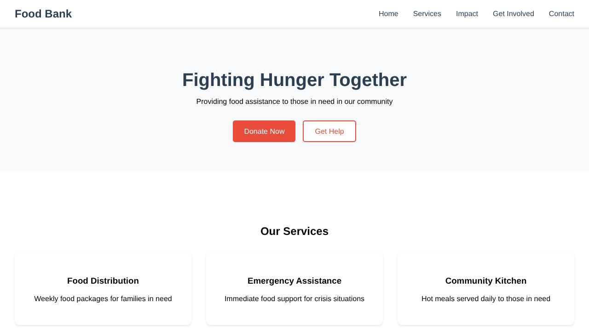

# 🍲 FoodBank Web

A responsive React web application built for a local food bank, designed to connect the community with the resources it needs. Visitors can learn about the food bank's services, see its impact through key statistics, and get involved by donating, volunteering, or fundraising through clean, interactive modals.



## ✨ Features

- **Hero Section**: a welcoming landing area with quick-access buttons to donate or request help.
- **Our Services**: highlights food distribution, emergency assistance, and community kitchen programs.
- **Our Impact**: key statistics such as meals served, families helped, and active volunteers.
- **Get Involved**: interactive cards for donating food, volunteering, or organizing a fundraiser.
- **Modals**: pop-up forms for Donate, Get Help, and Volunteer, closable with the × button, the Escape key, or by clicking outside.
- **Responsive layout**: sticky navigation that links to each section and adapts to phone screens.

> The forms are a front-end demo: submitting one shows a confirmation message, and no data is sent or stored.

## 🛠️ Built With

- [React 18](https://react.dev/): UI components and state with hooks (`useState`, `useEffect`)
- [Create React App](https://create-react-app.dev/): build tooling
- [React Testing Library](https://testing-library.com/docs/react-testing-library/intro/) + Jest: tests
- GitHub Actions + GitHub Pages: automated testing and deployment

## 🚀 Getting Started

### Prerequisites

- [Node.js](https://nodejs.org/) 18 or newer (20 LTS recommended), which includes npm

### Install and run

```bash
git clone https://github.com/<your-username>/foodbank-web.git
cd foodbank-web
npm install
npm start
```

The app opens at [http://localhost:3000](http://localhost:3000) and reloads when you edit a file.

### Available scripts

| Command | What it does |
| --- | --- |
| `npm start` | Runs the development server on port 3000 |
| `npm test` | Runs the test suite in watch mode |
| `npm run build` | Creates an optimized production build in `build/` |

## 📁 Project Structure

```
src/
├── App.js                  # Page layout and modal state
├── App.test.js             # Tests for sections, navigation and modals
├── index.css               # All styles
└── Components/
    ├── Navbar.js
    ├── Hero.js
    ├── Services.js
    ├── Impact.js
    ├── GetInvolved.js
    ├── Footer.js
    └── modals/
        ├── Modal.js        # Shared dialog (backdrop, Escape, close button)
        ├── DonateModal.js
        ├── HelpModal.js
        └── VolunteerModal.js
```

## 🌐 Deployment

Every push to `main` runs the tests, builds the app, and publishes it to GitHub Pages through [`.github/workflows/deploy.yml`](.github/workflows/deploy.yml).

To turn it on for your copy of the repository, open **Settings → Pages** and set **Source** to **GitHub Actions**. The site will then be live at `https://<your-username>.github.io/<repo-name>/`.

## 📌 About the Project

This was developed as a second-year university group project, with the goal of practicing component-based architecture, state management with React hooks, and building a real-world, socially impactful application.
